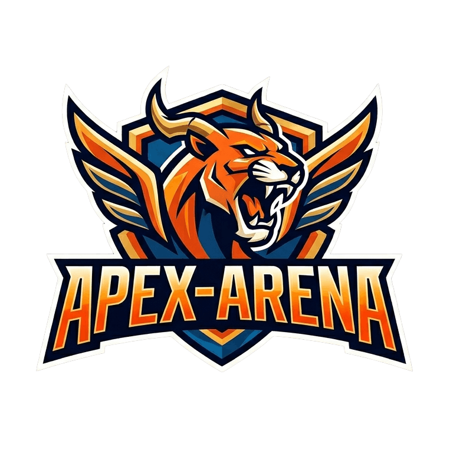

# ⚔️ Apex Arena



*A browser-based arena brawler in development.*

[](#roadmap)
[](#technology)
[](#technology)
[](#technology)

Apex Arena is an early-stage browser game project. The repository currently contains the web app shell, loading experience, client-side routing foundation, and supporting site/PWA files. Core playable combat and online multiplayer are still planned—not finished features.

- **Play / project site:** [rgithubpro.github.io/Apex-Arena](https://rgithubpro.github.io/Apex-Arena/)
- **Main game repository:** [Rgithubpro/Apex-Arena](https://github.com/Rgithubpro/Apex-Arena)
- **Companion assets repository:** [Rgithubpro/Apex-Arena-Assets](https://github.com/Rgithubpro/Apex-Arena-Assets)

## Project status

This project is actively being developed. The public site and client foundation are available, but the game is not yet a complete playable multiplayer experience. Screenshots will be added when gameplay and visuals are ready to share.

## Technology

- **HTML5 and CSS3** for the browser interface
- **Vanilla JavaScript (ES modules)** for client-side behavior and routing
- **Service worker and web app manifest** for installability and limited offline support
- **Backend middleware integration** is present in the client; game services and online gameplay are still under development

The companion [Apex-Arena-Assets repository](https://github.com/Rgithubpro/Apex-Arena-Assets) contains additional game assets and content tooling. See its README for its layout and manifest update workflow.

## Screenshots

Gameplay screenshots and battler previews are not ready yet. They will be added here when they are available.

## Run locally

### Prerequisites

- Git
- A local static web server (for example, the VS Code Live Server extension or Node.js `http-server`)

A local server is needed for browser module loading and fetch requests; opening `index.html` directly as a `file://` URL may not work correctly.

### Steps

```bash
git clone https://github.com/Rgithubpro/Apex-Arena.git
cd Apex-Arena
```

Start a static server from the repository root, then open the local URL it provides (Live Server commonly uses `http://localhost:5500`). Some features that depend on remote services require an internet connection and may not be implemented yet.

## Roadmap

The roadmap is a broad plan, not a release schedule. Priorities may change as development progresses. Items below are planned unless explicitly marked complete.

### 1. Client foundation

- [x] Set up the browser project and initial loading experience
- [x] Add a client-side routing foundation
- [x] Add web app manifest and service-worker scaffolding
- [ ] Complete and test navigation for the planned screens
- [ ] Establish shared UI patterns, responsive layouts, and loading/error states

### 2. Accounts and game data

- [ ] Decide and document the account, authentication, and session flow
- [ ] Connect client account/profile screens to reliable backend services
- [ ] Define and validate the data model for player profiles and game state
- [ ] Add safe persistence, input validation, and useful failure/retry behavior

### 3. Core game experience

- [ ] Build a playable prototype with player movement and basic combat
- [ ] Add battler abilities, health/damage rules, and match win conditions
- [ ] Create an initial arena and connect the game interface to live match state
- [ ] Test controls and gameplay across desktop and mobile browsers

### 4. Online multiplayer

- [ ] Design the authoritative multiplayer server and match lifecycle
- [ ] Implement matchmaking and joining/leaving matches
- [ ] Handle latency, disconnects, reconnects, and invalid or stale match state
- [ ] Run private playtests and tune stability and responsiveness

### 5. Progression and community

- [ ] Build out battler roster and player profile progression
- [ ] Add quests, events, rewards, and other progression systems
- [ ] Develop friends, clubs, and other social features
- [ ] Add matchmaking results and player-facing match history where appropriate

### 6. Release readiness

- [ ] Add automated checks for critical client and service flows
- [ ] Review accessibility, performance, privacy, and security
- [ ] Document supported browsers, known limitations, and deployment process
- [ ] Prepare public gameplay previews and a first release checklist

## Feedback and contributions

The project is currently in solo development. Feedback and bug reports are welcome—please open an [issue](https://github.com/Rgithubpro/Apex-Arena/issues) with clear steps and relevant details. Check with the maintainer before starting substantial changes.

## License

See [LICENCE](LICENCE). All rights are reserved; permission is required to reproduce or modify this project.

---

Designed and developed by Ralph.
